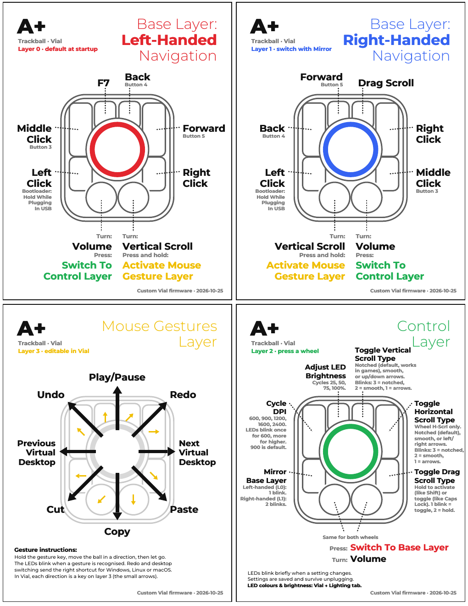

# Ploopy A+ Trackball — custom Vial firmware

This fork of [ploopyco/aplus-trackball](https://github.com/ploopyco/aplus-trackball)
adds a custom [Vial](https://get.vial.today/) firmware for the A+. It is built
around a left-handed layout, with remappable wheels and editable mouse gestures.



**[Keymap as a printable PDF](docs/img/keymap_vial.pdf)**

## Flashing

1. Download [`firmwares/aplus_vial.uf2`](firmwares/aplus_vial.uf2).
2. Unplug the A+, hold the **bottom-left button** (Left Click) and plug it back in.
   A drive called `RPI-RP2` appears.
3. Drag `aplus_vial.uf2` onto it. The A+ restarts by itself.

Flashing resets the saved Vial keymap and the A+ settings (handedness, scroll
modes, LED brightness) to the defaults shown above. To go back to Ploopy's
firmware, flash [`firmwares/aplus.uf2`](firmwares/aplus.uf2) the same way.

## What's different from Ploopy's firmware

| | Ploopy's firmware | This firmware |
|---|---|---|
| Startup layer | Right-handed (layer 0) | **Left-handed (layer 0)**, custom layout |
| Right-handed layout | Layer 0 | Layer 1, reached with **Mirror** on the control layer |
| Wheels | Fixed: vertical + horizontal scroll | **Remappable per layer in Vial**; default volume + vertical scroll |
| Scroll type | Smooth hi-res only (ignored by many games) | **Notched by default**, smooth or arrows selectable |
| LEDs | Fixed: left-handed green, control red | **Colours and brightness editable in Vial**; default left-handed red, right-handed blue, control green |
| Configurator | VIA, with a JSON file to load | **Vial**, detected automatically |
| Mouse gestures | Fixed | **Editable in Vial** (layer 3) |

DPI cycling, drag scroll, LED brightness, the gesture key, the OS-aware
shortcuts and saved settings work as on Ploopy's firmware.

## Customizing in Vial

Open [vial.rocks](https://vial.rocks) in Chrome or Edge, or the Vial desktop app,
and plug in the A+.

| Layer | What it is |
|---|---|
| 0 | Left-handed base, active at startup (red) |
| 1 | Right-handed base (blue) |
| 2 | Control layer (green) |
| 3 | Mouse gesture table, never switched on |
| 4–7 | Free for your own use |

- **Buttons:** click a key, pick a keycode. A+ functions (Gesture, Drag Scroll,
  DPI, LED brightness, the scroll toggles, Mirror, wheel scroll modes) are in the
  **User** tab.
- **Wheels:** each wheel is a pair of round keys under the layout:
  counter-clockwise and clockwise, for every layer.
  - Any keycode is sent once per notch (volume, media keys, arrows, macros …).
  - **Wheel V-Scrl** / **Wheel H-Scrl** (User tab) make it a scroll wheel.
    Put it in both slots; put it in only the counter-clockwise slot to reverse it.
  - **Scroll type:** notched by default, one full notch at a time like a normal
    mouse, so it works in game menus. Smooth hi-res scrolling is smoother in
    browsers but many games ignore it. Set it either way:
    - **In Vial:** put **V-Scrl Notch** or **V-Scrl Smooth** (or the H-Scrl
      versions) on a wheel. These fixed types work per wheel and per layer, so a
      gaming layer can be notched and another smooth.
    - **On the trackball:** with plain **Wheel V-Scrl / H-Scrl** on the wheel,
      the control layer's Toggle Vertical / Horizontal Scroll Type buttons cycle
      notched (3 blinks) → smooth (2 blinks) → arrow keys (1 blink).
- **Gestures:** layer 3's eight keys are the eight gesture directions, going
  clockwise from the top-left key (the small arrows on the keymap). A
  transparent key keeps the built-in OS-aware action; a Vial macro (`M0`, `M1` …)
  can do anything else.
- **LEDs:** open the **Lighting** tab. The colour picker sets the colour of
  whatever is lit right now: switch the A+ to a layer (Mirror for the
  right-handed layer, a wheel press for the control layer) and pick its colour.
  To change the gesture colour, hold the gesture key while picking. Brightness
  applies to all colours; Effect "All Off" turns the LEDs off. Changes save
  automatically after a moment.
- **Unlocking** (only needed for the matrix tester or `QK_BOOT`): hold the two
  big bottom buttons when Vial asks.

More detail is in [`firmware/vial/README.md`](firmware/vial/README.md).

## Building the firmware

```sh
cd firmware/vial
./build.sh            # clones vial-qmk next to the script, or
./build.sh ~/vial-qmk # uses an existing checkout
```

Needs a normal QMK build environment. The source is in
[`firmware/vial/keyboards/ploopyco/`](firmware/vial/keyboards/ploopyco/). It is
Ploopy's A+ firmware from the `ploopyco/a+` branch of
[ploopyco/qmk_firmware](https://github.com/ploopyco/qmk_firmware), ported to
[vial-qmk](https://github.com/vial-kb/vial-qmk).

To regenerate the keymap sheet after changing the layout, edit
[`firmware/vial/keymap-sheet/make_keymap.py`](firmware/vial/keymap-sheet/make_keymap.py)
and run `build_sheet.sh` in that folder. It needs `wkhtmltopdf`, `pdftoppm` and
the Montserrat font.

## The A+ itself

This repository also keeps Ploopy's design and production files and assembly
documentation for building an A+. See [Ploopy's documentation site](https://ploopyco.github.io/aplus-trackball/)
or the [`docs/`](docs/) and [`hardware/`](hardware/) folders. Ploopy's original
keymap is [`docs/img/keymap.pdf`](docs/img/keymap.pdf).

## License

As per QMK's licensing requirements, the firmware is released under GPLv3.
Hardware design files, including electronics and mechanical files, are released
under CERN OHL v2-S. See the respective directories for the full license text.
